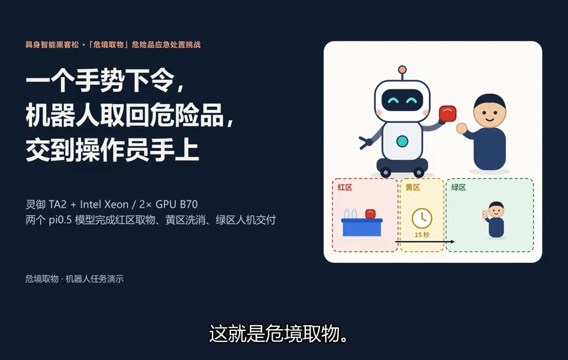
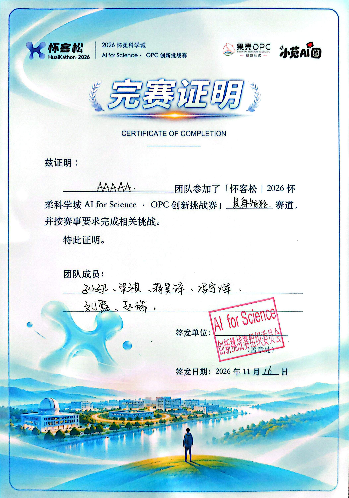
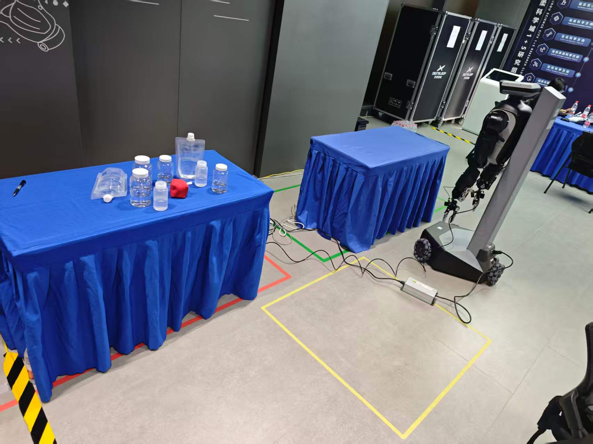
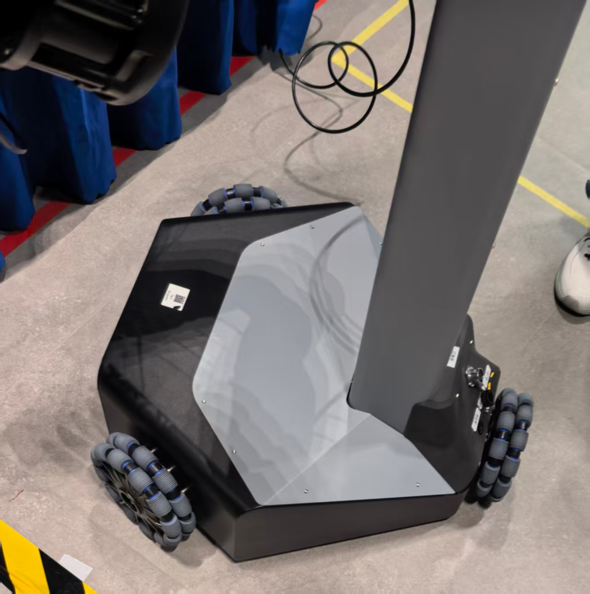

# 危境取物：一个手势下令，机器人取回危险品并交到操作员手上

「怀客松 HuaiKathon 2026｜怀柔科学城 AI for Science · OPC 创新挑战赛」具身智能赛道参赛项目，团队 **AAAAA**。

操作员比一个 OK 手势，灵御 TeleAvatar 2（TA2）机器人自己走完整条任务链：到红区抓起沙包（模拟危险品），带到黄区停留洗消，再到绿区把沙包递到人手上。手势之后不需要人工干预，演示记录的全程用时约 140 秒。

灵巧操作（抓取、递交）由两个微调过的 pi0.5 视觉语言动作模型完成，移动、对位、状态判断和安全把关由规则程序完成。推理跑在 Intel Xeon + 两张 Arc Pro B70 显卡上，一张卡驻留一个模型。

## 演示视频

[](111.mp4)

点击封面打开 [`111.mp4`](111.mp4)（3 分 40 秒，带解说字幕），内容是方案讲解和真机实拍画面。演示文稿原件是 [`危境取物_演示_v4(1).pptx`](危境取物_演示_v4(1).pptx)。

## 完赛证书



团队 AAAAA 参加具身智能赛道并按赛事要求完成挑战，证书由 AI for Science 创新挑战赛组织委员会于 2026 年 11 月 16 日签发。

## 现场与机器人

| 比赛场地 | TA2 全向底盘 |
| --- | --- |
|  |  |

地面的红、黄、绿胶带框分别是取物区、洗消区和交付区。主桌上的红色沙包是要取回的目标。

## 任务流程

1. **待命**：机器人后退 30 厘米，抬臂到起始姿态，回位，然后用头部相机等待 OK 手势。
2. **确认指令**：识别到手势并保持 1 秒后，两个夹爪开合两次，表示已收到命令。
3. **到红区**：底盘左移 144 厘米到主桌前，再按沙包在头部图像里的位置微调底盘。
4. **抓取**：抓取模型抓起沙包。程序读右夹爪开度确认抓到，没抓到就收臂、重新对位再抓一次。
5. **黄区洗消**：带着沙包右移到黄区，停留 15 秒。
6. **到绿区**：再右移 72 厘米，把沙包放到桌面，等 5 秒后重新夹起。
7. **交付**：递交模型把沙包递出，模型输出"张开"时松手，3 秒后手臂收回。

## 技术方案

| 环节 | 做法 |
| --- | --- |
| 抓取、递交 | 遥操作采集示范数据，微调两个 pi0.5 模型，各自常驻一张 B70 显卡，任务开始时都预热好，中途切换不停顿 |
| 移动 | 底盘开环速度控制，按卷尺实测的比例换算时长 |
| 对位 | 在头部相机图像里找红色沙包，换算成底盘位移，最多修正三轮 |
| 手势识别 | 肤色分割后取手的轮廓，与模板比轮廓重合度和倒角距离，代码在 `gesture_gate.py` |
| 安全把关 | 夹爪开度判断是否抓到；递交前检查模型给的第一个目标与当前姿态的差距；网络丢包过高时不启动 |

演示文稿里记录的实测数据：手势识别 5/5，红区抓取 5/5，往返黄区洗消 5/5，夹住后交到手上 4/4；单次推理约 0.2 秒，视频硬件解码 12 到 14 毫秒。

## 仓库内容

```
.
├── README.md                        本文件
├── 111.mp4                          演示视频
├── 99.jpg                           完赛证书
├── 20.jpg / 1000.jpg                场地和机器人照片
├── 危境取物_演示_v4(1).pptx          演示文稿
├── openpi-xpu-env_部署说明.md        推理环境镜像：加载、转换 checkpoint、启动服务
├── B70_Handover_模型部署指南.md      递交模型在 B70 上的部署和试跑步骤
├── B70.txt.example                  B70 连接信息的格式样例
├── label/                           OK 手势模板（8 张近景图）
└── teleavatar2/
    ├── env.sh / start_bridge.sh     本机 ROS 2 环境和 zenoh 桥接
    ├── chassis_move.py              底盘运动脚本
    ├── 底盘运动指令.md               底盘控制手册
    └── b70/                         比赛用的全部任务脚本，说明见 b70/README.md
```

主要脚本都在 [`teleavatar2/b70/`](teleavatar2/b70/)，详细用法、参数和已知问题写在 [`teleavatar2/b70/README.md`](teleavatar2/b70/README.md)。

## 运行

脚本在本机启动，通过 SSH 送进 B70 服务器上的客户端容器 `openpi-xpu-client` 执行。

```bash
cd teleavatar2/b70
./run_gesture_combo.sh --check    # 只做启动前检查，机器人不动
./run_gesture_combo.sh            # 一键启动：手势待命 → 抓取 → 洗消 → 交付
./stop_task.sh                    # 中途停止
```

运行前需要自己准备这几样，仓库里没有：

- **B70 连接信息**：按 `B70.txt.example` 的格式写一份 `B70.txt`。`askpass.sh` 里读取它的路径是 `/home/jhz/workspace/B70.txt`，换机器时要改。
- **zenoh 桥接程序**：下载 `zenoh-bridge-ros2dds` v1.9.0 放到 `teleavatar2/bin/`。Ubuntu 22.04 不能用 1.10.x，它要求 glibc 2.38。
- **模型和推理服务**：两个 pi0.5 checkpoint 和推理镜像 `openpi-xpu-env:v0.1.0` 不在仓库里，部署步骤见下面的[部署](#部署)一节。
- **运行日志**：`teleavatar2/b70/logs/` 里的日志和过程图像约 1.2 GB，没有上传。

脚本会驱动机械臂和底盘，而且不检查现场有没有人。运行前确认路径上无人，并留人守急停。

## 部署

推理服务和机器人客户端都跑在 B70 服务器的 Docker 容器里。部署分两层，各有一份文档：

| 文档 | 内容 |
| --- | --- |
| [`openpi-xpu-env_部署说明.md`](openpi-xpu-env_部署说明.md) | 推理环境镜像 `openpi-xpu-env:v0.1.0` 的通用用法：加载镜像、冒烟测试、转换 checkpoint、启动服务、编译缓存和绑核 |
| [`B70_Handover_模型部署指南.md`](B70_Handover_模型部署指南.md) | 本项目递交模型的具体部署：服务启动命令、TA2 客户端检查、真机试跑 |

整体步骤如下，命令细节以两份文档为准。

1. **加载镜像**：`docker load -i openpi-xpu-env_v0.1.0.tar.gz`。镜像不含 openpi 源码，源码在宿主机上，运行时挂载到容器的 `/app`，需使用 `feat/teleavatar-v2-server-b70` 分支。
2. **冒烟测试**：在容器里确认 `torch.xpu.is_available()` 为 `True`，能看到 B70 显卡。
3. **转换 checkpoint**：训练得到的是 JAX checkpoint，B70 上推理要转成 PyTorch。每个 checkpoint 转一次，在 CPU 上进行，约需 32 GB 内存。转完在 `assets/` 下建一个名为 `path-to-dataset` 的软链接，指向数据集目录。
4. **启动推理服务**：每个模型一个容器，用 `ZE_AFFINITY_MASK` 选显卡，加 `--warmup` 在监听端口前完成编译。
5. **启动客户端容器** `openpi-xpu-client`：通过 zenoh 连到 TA2（`tcp/<TA2 地址>:9000`，`ROS_DOMAIN_ID=29`）。TA2 上把运行模式设为 API，左右臂设为关节控制，视频推流到 B70 的 UDP 8890 端口。
6. **运行任务**：用上一节的一键脚本。

比赛时 B70 上的服务分布：

| 服务 | 端口 | 显卡 | 模型 |
| --- | --- | --- | --- |
| 抓取模型 | `127.0.0.1:8000` | 第一张 | pi0.5 抓取，5221 步 |
| 递交模型 | `127.0.0.1:8001` | 第二张 | `sandbag_handover_224_v1`，5907 步，容器 `ta2-handover-5907` |
| 新抓取模型（备用） | `127.0.0.1:8002` | 第一张 | `sandbag_rec_224_v2`，9264 步，容器 `ta2-sandbag-9264` |

两点容易踩的地方：

- **递交模型按绝对关节角输出**，要用 `serve_handover_5907.py` 启动。原版 `serve_policy.py` 的同名配置按增量解释，会把当前关节角额外加到目标上。这个启动脚本在 B70 服务器上，不在本仓库里。
- **`torch.compile` 首次编译要 65 到 100 秒**，有缓存后启动约 22 秒。升级 torch、驱动或镜像后要清空编译缓存目录。

## 硬件与软件

| 项目 | 配置 |
| --- | --- |
| 机器人 | 灵御 TeleAvatar 2，双臂加全向底盘 |
| 算力 | Intel Xeon，2 张 Intel Arc Pro B70 |
| 模型 | pi0.5（openpi），PyTorch XPU 推理 |
| 通讯 | ROS 2 Humble，zenoh-bridge-ros2dds |
